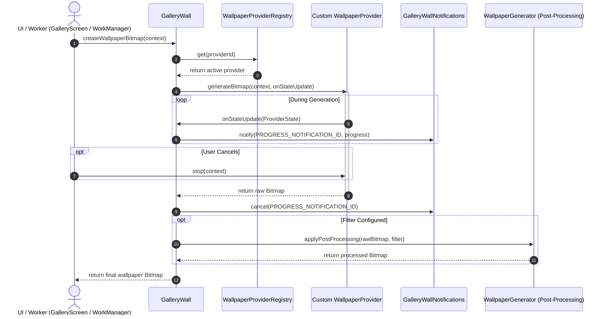

# Custom Wallpaper Provider Guide

This guide explains how to build, register, and test a custom wallpaper provider in **GalleryWall**.

---

## 1. Architecture Overview

GalleryWall uses the **Strategy Pattern** to support extensible wallpaper generation. Whether generating wallpapers using on-device neural networks, remote cloud AI endpoints, or procedural mathematical canvas algorithms, all generators implement the `WallpaperProvider` interface and register with `WallpaperProviderRegistry`.



### Key Components

- **[`WallpaperProvider`](file:///Users/oleg/Developer/galleryagent/android/app/src/main/java/com/baysoft/gallerywall/provider/WallpaperProvider.kt)**: Defines the contract for wallpaper generation, readiness checks, and cancellation.
- **[`WallpaperProviderRegistry`](file:///Users/oleg/Developer/galleryagent/android/app/src/main/java/com/baysoft/gallerywall/provider/WallpaperProviderRegistry.kt)**: Thread-safe runtime registry that stores available providers.
- **[`GalleryWall`](file:///Users/oleg/Developer/galleryagent/android/app/src/main/java/com/baysoft/gallerywall/GalleryWall.kt)**: The generation engine. Handles provider lookup, notification dispatch, post-processing filters, and system wallpaper updates.
- **[`ProvidersScreen`](file:///Users/oleg/Developer/galleryagent/android/app/src/main/java/com/baysoft/gallerywall/ui/ProvidersScreen.kt)**: Compose UI that lists all registered providers and lets the user choose the active provider.

---

## 2. The `WallpaperProvider` Interface Contract

To create a new provider, implement `WallpaperProvider`:

```kotlin
package com.baysoft.gallerywall.provider

import android.content.Context
import android.graphics.Bitmap
import androidx.annotation.StringRes

interface WallpaperProvider {
    /** Unique string identifier persisted in preferences. */
    val id: String

    /** Localized title string resource displayed in the Providers screen. */
    @get:StringRes
    val titleRes: Int

    /** Localized summary string resource displayed in the Providers screen. */
    @get:StringRes
    val summaryRes: Int

    /**
     * Generates a wallpaper bitmap.
     * Executes synchronously on a background thread.
     * Intermediate progress should be reported via [onStateUpdate].
     */
    fun generateBitmap(
        context: Context,
        onStateUpdate: (ProviderState) -> Unit = {}
    ): Bitmap

    /**
     * Checks if the provider is ready to generate.
     * Defaults to [ProviderReadiness.READY].
     */
    fun isReady(context: Context): ProviderReadiness = ProviderReadiness.READY

    /**
     * Callback invoked when generation is stopped or cancelled by the user.
     */
    fun stop(context: Context) {}
}
```

### Readiness States (`ProviderReadiness`)

| State | Description | UI Behavior |
|-------|-------------|-------------|
| `READY` | Provider is fully ready without user input. | Generate button is enabled; prompt overlay not strictly required. |
| `PROMPT` | Provider accepts or requires a prompt (e.g., text prompt for AI). | Enables prompt input UI in Gallery and Automation tabs. |
| `NONE` | Prerequisites missing (e.g. no AI model downloaded, missing API key). | Alerts user to configure provider or download prerequisites. |

### Progress Reporting (`ProviderState`)

During `generateBitmap`, publish progress updates to the caller:

```kotlin
onStateUpdate(
    DefaultProviderState(
        progress = 0.5f,                    // Float between 0.0f and 1.0f
        message = "Generating wallpaper…",  // User-facing progress string
        result = null,                      // Set to the Bitmap once complete
        error = null                        // Non-null if generation failed
    )
)
```

> [!NOTE]
> For non-local AI providers, `GalleryWall` automatically bridges these `ProviderState` callbacks into Android system notifications with an animated progress bar and a "Stop" action button.

---

## 3. Registering Your Provider

Register your custom provider with `WallpaperProviderRegistry` at application startup.

### In `GalleryApplication.onCreate()`

Open [`GalleryApplication.kt`](file:///Users/oleg/Developer/galleryagent/android/app/src/main/java/com/baysoft/gallerywall/GalleryApplication.kt) and register your provider:

```kotlin
package com.baysoft.gallerywall

import android.app.Application
import androidx.preference.PreferenceManager
import com.baysoft.gallerywall.provider.WallpaperProviderRegistry
import com.baysoft.gallerywall.provider.GradientWallpaperProvider

class GalleryApplication : Application() {

    override fun onCreate() {
        super.onCreate()
        Settings.migrateLegacyPrefsIfNeeded(PreferenceManager.getDefaultSharedPreferences(this))
        GalleryWallNotifications.createNotificationChannel(this)

        // Register custom providers
        WallpaperProviderRegistry.register(GradientWallpaperProvider)
    }
}
```

The provider will automatically appear in the **Providers** tab list in the app UI, and users can select it immediately.

---

## 4. Built-In Features Handled Automatically

When implementing a custom provider, GalleryWall handles the following system integrations automatically:

1. **System Progress Notifications**:
   - Calls `GalleryWallNotifications.buildProgressNotification(...)` with your emitted messages and percentage progress.
   - Automatically posts and dismisses notification ID `PROGRESS_NOTIFICATION_ID`.
2. **Post-Processing Image Filters**:
   - The user's chosen filter (**Black & White**, **Sepia**, **Invert**, or **Blur**) is applied directly to the `Bitmap` returned by `generateBitmap()`.
3. **Background Automation & WorkManager**:
   - When automation is scheduled, `GalleryWallRefreshWorker` runs in the background, checks execution conditions (charging, idle, battery), invokes your provider's `generateBitmap()`, and saves the wallpaper to the internal gallery database.
4. **Cancellation Hook**:
   - If the user taps "Stop" on the progress notification or closes the generation dialog, `stop(context)` is called on your provider.

---

## 5. Step-by-Step Implementation Tutorials

### Tutorial 1: Procedural Canvas Provider (Offline)

This example generates a colorful, algorithmic gradient wallpaper with cancellation support and progress reporting.

#### Step 1: Add String Resources
In `app/src/main/res/values/strings.xml`:
```xml
<string name="provider_gradient_title">Dynamic Gradient</string>
<string name="provider_gradient_summary">Procedural algorithmic multi-stop color gradient.</string>
```

#### Step 2: Implement `GradientWallpaperProvider.kt`
Create `app/src/main/java/com/baysoft/gallerywall/provider/GradientWallpaperProvider.kt`:

```kotlin
package com.baysoft.gallerywall.provider

import android.content.Context
import android.graphics.Bitmap
import android.graphics.Canvas
import android.graphics.LinearGradient
import android.graphics.Paint
import android.graphics.Shader
import com.baysoft.gallerywall.R
import java.util.Random
import java.util.concurrent.CancellationException

object GradientWallpaperProvider : WallpaperProvider {

    @Volatile
    private var isCancelled = false

    override val id: String = "dynamic_gradient"
    override val titleRes: Int = R.string.provider_gradient_title
    override val summaryRes: Int = R.string.provider_gradient_summary

    override fun generateBitmap(
        context: Context,
        onStateUpdate: (ProviderState) -> Unit
    ): Bitmap {
        isCancelled = false

        // 1. Report starting progress
        onStateUpdate(DefaultProviderState(progress = 0.1f, message = "Initializing canvas…"))

        // Check cancellation
        if (isCancelled) throw CancellationException("Cancelled by user")

        // 2. Resolve display metrics for high-resolution output
        val metrics = context.resources.displayMetrics
        val width = metrics.widthPixels.coerceAtLeast(1080)
        val height = metrics.heightPixels.coerceAtLeast(1920)

        onStateUpdate(DefaultProviderState(progress = 0.4f, message = "Calculating color palette…"))

        val rng = Random()
        val color1 = (0xFF000000 or rng.nextInt(0x1000000).toLong()).toInt()
        val color2 = (0xFF000000 or rng.nextInt(0x1000000).toLong()).toInt()
        val color3 = (0xFF000000 or rng.nextInt(0x1000000).toLong()).toInt()

        if (isCancelled) throw CancellationException("Cancelled by user")

        // 3. Render bitmap
        onStateUpdate(DefaultProviderState(progress = 0.8f, message = "Rendering gradient…"))

        val bitmap = Bitmap.createBitmap(width, height, Bitmap.Config.ARGB_8888)
        val canvas = Canvas(bitmap)
        val paint = Paint().apply {
            shader = LinearGradient(
                0f, 0f, width.toFloat(), height.toFloat(),
                intArrayOf(color1, color2, color3),
                null,
                Shader.TileMode.CLAMP
            )
        }
        canvas.drawRect(0f, 0f, width.toFloat(), height.toFloat(), paint)

        // 4. Complete
        onStateUpdate(DefaultProviderState(progress = 1.0f, result = bitmap, message = "Done"))
        return bitmap
    }

    override fun isReady(context: Context): ProviderReadiness = ProviderReadiness.READY

    override fun stop(context: Context) {
        isCancelled = true
    }
}
```

---

### Tutorial 2: Remote Cloud / Generative AI Provider

This example illustrates calling a remote AI generation service (such as Firebase Vertex AI, an Imagen endpoint, or a REST API) using user prompts from `Settings`.

#### Step 1: Add Internet Permission (if not already present)
In `app/src/main/AndroidManifest.xml`:
```xml
<uses-permission android:name="android.permission.INTERNET" />
```

#### Step 2: Implement `CloudAIProvider.kt`
Create `app/src/main/java/com/baysoft/gallerywall/provider/CloudAIProvider.kt`:

```kotlin
package com.baysoft.gallerywall.provider

import android.content.Context
import android.graphics.Bitmap
import android.graphics.BitmapFactory
import androidx.preference.PreferenceManager
import com.baysoft.gallerywall.R
import com.baysoft.gallerywall.Settings
import java.io.InputStream
import java.net.HttpURLConnection
import java.net.URL
import java.util.concurrent.CancellationException

object CloudAIProvider : WallpaperProvider {

    override val id: String = "cloud_ai"
    override val titleRes: Int = R.string.provider_cloud_title
    override val summaryRes: Int = R.string.provider_cloud_summary

    @Volatile
    private var activeConnection: HttpURLConnection? = null

    override fun generateBitmap(
        context: Context,
        onStateUpdate: (ProviderState) -> Unit
    ): Bitmap {
        val prefs = PreferenceManager.getDefaultSharedPreferences(context)
        val settings = Settings(prefs)
        val prompt = settings.automationPrompt

        onStateUpdate(DefaultProviderState(progress = 0.1f, message = "Connecting to cloud engine…"))

        try {
            // Read configured API endpoint
            val endpointUrl = URL("https://api.example.com/generate?prompt=${java.net.URLEncoder.encode(prompt, "UTF-8")}")
            val connection = (endpointUrl.openConnection() as HttpURLConnection).apply {
                connectTimeout = 15000
                readTimeout = 30000
                requestMethod = "GET"
            }
            activeConnection = connection

            onStateUpdate(DefaultProviderState(progress = 0.5f, message = "Synthesizing wallpaper…"))

            val responseCode = connection.responseCode
            if (responseCode != HttpURLConnection.HTTP_OK) {
                throw IllegalStateException("Cloud API error: HTTP $responseCode")
            }

            onStateUpdate(DefaultProviderState(progress = 0.85f, message = "Decoding image stream…"))
            val inputStream: InputStream = connection.inputStream
            val bitmap = BitmapFactory.decodeStream(inputStream)
                ?: throw IllegalStateException("Failed to decode image from cloud response.")

            onStateUpdate(DefaultProviderState(progress = 1.0f, result = bitmap, message = "Done"))
            return bitmap
        } catch (e: Exception) {
            if (e is CancellationException) throw e
            val error = IllegalStateException("Cloud generation failed: ${e.message}", e)
            onStateUpdate(DefaultProviderState(progress = 0f, error = error, message = error.message))
            throw error
        } finally {
            activeConnection?.disconnect()
            activeConnection = null
        }
    }

    override fun isReady(context: Context): ProviderReadiness {
        // Readiness can check network availability or required credentials
        return ProviderReadiness.PROMPT
    }

    override fun stop(context: Context) {
        activeConnection?.disconnect()
    }
}
```

---

## 6. Unit Testing Your Custom Provider

GalleryWall uses Robolectric for JVM unit testing. You can test your provider's registration, bitmap generation, and cancellation behavior without needing a physical device or emulator.

Add a test in `app/src/test/java/com/baysoft/gallerywall/`:

```kotlin
package com.baysoft.gallerywall

import android.content.Context
import androidx.test.core.app.ApplicationProvider
import com.baysoft.gallerywall.provider.GradientWallpaperProvider
import com.baysoft.gallerywall.provider.WallpaperProviderRegistry
import org.junit.After
import org.junit.Assert.*
import org.junit.Before
import org.junit.Test
import org.junit.runner.RunWith
import org.robolectric.RobolectricTestRunner
import org.robolectric.annotation.Config

@RunWith(RobolectricTestRunner::class)
@Config(sdk = [33])
class CustomProviderTest {

    private lateinit var context: Context

    @Before
    fun setUp() {
        context = ApplicationProvider.getApplicationContext()
        WallpaperProviderRegistry.register(GradientWallpaperProvider)
    }

    @After
    fun tearDown() {
        WallpaperProviderRegistry.unregister(GradientWallpaperProvider)
    }

    @Test
    fun provider_isRegisteredSuccessfully() {
        val provider = WallpaperProviderRegistry.get(GradientWallpaperProvider.id)
        assertNotNull(provider)
        assertEquals(GradientWallpaperProvider.id, provider?.id)
    }

    @Test
    fun provider_generatesValidBitmap() {
        val bitmap = GradientWallpaperProvider.generateBitmap(context)
        assertNotNull(bitmap)
        assertTrue(bitmap.width >= 1080)
        assertTrue(bitmap.height >= 1920)
    }

    @Test
    fun provider_cancellationThrowsException() {
        val thread = Thread {
            assertThrows(java.util.concurrent.CancellationException::class.java) {
                GradientWallpaperProvider.generateBitmap(context)
            }
        }
        thread.start()
        GradientWallpaperProvider.stop(context)
        thread.join(2000)
    }
}
```

---

## 7. Manual Verification Checklist

1. **Verify Provider Listing**:
   - Launch GalleryWall.
   - Tap the **Providers** tab in bottom navigation.
   - Ensure your custom provider card appears with its title and description.
2. **Select & Generate**:
   - Tap the card to select your provider (a checkmark appears).
   - Navigate to the **Wallpapers** tab.
   - Tap the **Refresh / Generate** button.
   - Observe the progress notification with percentage progress.
3. **Verify Post-Processing**:
   - Go to Settings, choose a post-processing filter (e.g., *Black & White* or *Blur*).
   - Generate a wallpaper again and confirm the filter is applied to the final result.
4. **Test Cancellation**:
   - While generation is in progress, tap **Stop** on the notification or cancellation dialog.
   - Confirm generation terminates cleanly without leaking threads.
